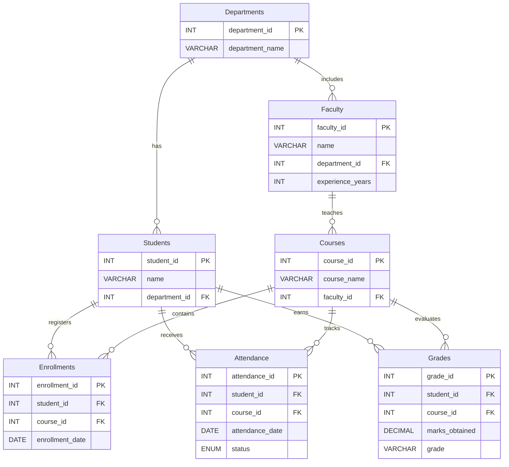

<div align="center">

# 🎓 Student Performance & Attendance Tracker

### A MySQL Database Management System Project

**Track students. Monitor attendance. Analyze academic performance.**

<p>
  
  
  
</p>

</div>

---

## 📌 Project Overview

The **Student Performance & Attendance Tracker** is a database project designed to organize student information, academic courses, faculty details, enrollments, attendance records, and grades in one structured MySQL database.

It demonstrates core and intermediate SQL concepts through practical queries, helping users retrieve meaningful academic insights such as student marks, attendance percentages, department-wise student counts, and course enrollment summaries.

## 🎯 Objectives

- Store student, faculty, department, and course information systematically.
- Maintain course enrollment records for students.
- Record attendance with `Present`, `Absent`, and `Late` statuses.
- Store marks and grades for enrolled students.
- Generate useful reports using SQL queries.
- Practice relational database design, primary keys, foreign keys, and data integrity.

## 🧰 Technology Stack

| Component | Technology |
|---|---|
| Database | MySQL |
| Query Language | SQL |
| Database Client | MySQL Workbench or compatible MySQL client |
| Project Type | DBMS / SQL Project |

## 🗂️ Database Schema

The database is named **`student_tracker`** and contains seven related tables.

| Table | Purpose |
|---|---|
| `Departments` | Stores department IDs and department names. |
| `Students` | Stores student details and their department reference. |
| `Faculty` | Stores faculty details and department references. |
| `Courses` | Stores course details and assigned faculty. |
| `Enrollments` | Connects students to the courses they take. |
| `Attendance` | Records attendance by student, course, date, and status. |
| `Grades` | Stores marks and grade information for students and courses. |

### 🔗 Relationship Summary

- One department can have many students.
- One department can have many faculty members.
- A faculty member can be assigned to multiple courses.
- Students and courses are connected through `Enrollments`.
- Attendance records reference a student and a course.
- Grade records reference a student and a course.

### 🧱 Simplified ER Diagram



## ⚙️ Features & SQL Concepts

### 1. Data Management (CRUD)
- **Create:** Insert new records into tables.
- **Read:** Retrieve records using `SELECT`.
- **Update:** Modify student or faculty information.
- **Delete:** Remove records when appropriate.

### 2. Filtering & Sorting
- `WHERE`, `AND`, `OR`, `NOT`
- `ORDER BY`, `LIMIT`
- Filtering grouped results with `HAVING`

### 3. Aggregate Functions
- `COUNT()`, `SUM()`, `AVG()`, `MIN()`, `MAX()`

### 4. Joins
- `INNER JOIN`, `LEFT JOIN`, `RIGHT JOIN`
- `FULL OUTER JOIN` can be emulated in MySQL with a suitable `UNION` of left and right joins.

### 5. Advanced SQL
- Subqueries
- `GROUP BY` and `HAVING`
- `CASE` expressions
- Date functions such as `CURDATE()`, `TIMESTAMPDIFF()`, `MONTH()`, and `DATE_FORMAT()`
- String functions such as `UPPER()`, `TRIM()`, and `COALESCE()`
- Window functions such as `RANK()` and cumulative aggregates with `OVER()`

## 📊 Example Reports

The project can generate reports such as:

- Student list with department names.
- Top marks and course-wise results.
- Average, highest, and lowest marks.
- Department-wise student counts.
- Student attendance percentages.
- Students with attendance below a chosen threshold.
- Faculty members filtered by years of experience.
- Monthly enrollments and running totals.
- Ranking students by marks.

> **Note:** Report results depend on the sample records currently inserted in the database.

## 🚀 Getting Started

### Prerequisites

- MySQL Server 8.0 or a compatible version supporting the SQL features used.
- MySQL Workbench or another MySQL client.
- The project SQL script: `student_tracker.sql`.

### Setup Instructions

1. Open MySQL Workbench and connect to your MySQL server.
2. Open `student_tracker.sql`.
3. Review the script and confirm whether it creates the database and tables, and inserts the sample data.
4. Execute the script in order.
5. Select the database:

   ```sql
   USE student_tracker;
   ```

6. Confirm that all seven tables exist:

   ```sql
   SHOW TABLES;
   ```

7. Run the report queries and compare the output with the data in the tables.

> **Important:** If you have already inserted the sample data manually, do not rerun the `INSERT` statements blindly. Duplicate primary keys may cause errors. Use a clean database or follow the reset instructions in your SQL script.

## 🧪 Basic Verification Queries

```sql
USE student_tracker;

SHOW TABLES;

SELECT * FROM Students;
SELECT * FROM Departments;
SELECT * FROM Faculty;
SELECT * FROM Courses;
SELECT * FROM Enrollments;
SELECT * FROM Attendance;
SELECT * FROM Grades;
```

## 📁 Suggested Repository Structure

```text
Student-Performance-Attendance-Tracker/
├── README.md
└── student_tracker.sql
```

## 🔒 Data Integrity

- Primary keys uniquely identify records.
- Foreign keys link related tables.
- `UNIQUE` constraints help prevent duplicate department names and duplicate student-course enrollments.
- Attendance status is restricted to the supported values in the table definition.
- Sample names and email addresses are illustrative project data.

## 🌱 Future Enhancements

- Build a web dashboard for students and faculty.
- Add automatic attendance alerts.
- Generate downloadable academic reports.
- Add semester-wise examinations and grade history.
- Create views and stored procedures for frequently used reports.

## 👨‍🎓 Author

**Author:** *[krisha kukadiya]*

## ✅ Conclusion

The Student Performance & Attendance Tracker demonstrates how a relational database can organize academic information and support useful reporting. By using related tables, keys, constraints, joins, aggregate functions, subqueries, and window functions, the project provides practical experience with SQL and database management.

## 🙏 Thank You

<div align="center">

### Thank you for visiting this project!

Thank you to my faculty and institution for their guidance and support.  
This project has helped me strengthen my understanding of MySQL, SQL queries, and relational database concepts.

**Questions or suggestions are welcome.**

---

**Created with 💙 using MySQL and SQL**

</div>
